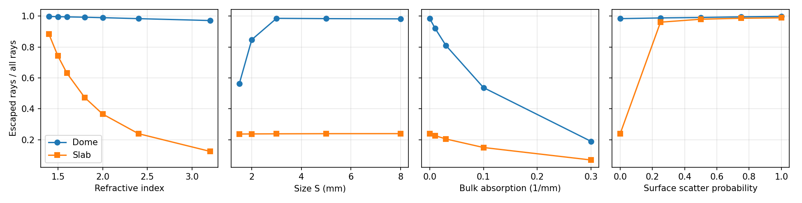

# Dome or slab: a light extraction ray tracer

This project asks if a glass dome extracts light from a flat emitter better than a slab. I started it in summer 2025 in the NBE research group at Aalto University, and I continued it in 2026. My old boss agreed to this publication.

## From pvtrace to my own tracer

In 2025, I built the simulation on the `pvtrace` library. I changed the library's tracing code and tried to speed it up with an OpenCL GPU path. It was still slow: tracing rays one by one on the CPU reached about 5 rays per second in a lossless slab. I ran out of time before I had comprehensive results.

I then saw that this problem does not need a general ray-tracing library. Both shapes are convex, so the distance to the next surface has an exact formula, and NumPy can move all rays at once. `fast_tracer.py` uses no ray-tracing library and no GPU. It reached about 300 000 rays per second in a similar slab, on one CPU core. The settings are not identical, so treat the speed gain as approximate.

```bash
pip install -r requirements.txt
python3 fast_tracer.py          # about 20 s; prints the tables and saves dome_vs_slab.png
python3 -m pytest               # checks the physics against exact answers
```



## Physics

- Lambertian emission from a uniform emitter on the base
- Unpolarized Fresnel reflection and total internal reflection on every glass surface
- Beer-Lambert absorption in the glass
- Optional Lambertian scattering when a ray reflects from the dome surface or the slab top
- An emitter that absorbs 10% of returning rays and reflects the rest

The tracer keeps the same core ray physics as the 2025 version. It has 2 differences: the 2025 option for a luminophore (a material that shifts the wavelength) is gone, and the emitter is now flat, not a thin absorbing cylinder.

It uses ray optics at one wavelength. It has no wave effects. Light that leaves through any surface counts as extracted, and the tables also show the upward part. `trace(..., base="mirror")` models a reflective base.

## Checks against exact answers

`test_fast_tracer.py` compares the tracer with results that do not come from the tracer:

| Check | Exact answer |
|---|---|
| Fresnel reflectance | ((n-1)/(n+1))² at normal incidence, total internal reflection and the Brewster case |
| Point emitter at the dome centre | T / (1 - R(1 - A)) |
| Rays trapped forever in a perfect box | The fraction of directions outside all 6 escape cones (25.9% at n = 1.5) |
| Very wide slab | The Fresnel series between 2 surfaces, integrated over the emission |
| Bulk absorption | exp(-αR) |
| Dome size | Light loss starts when emitter radius / dome radius is greater than 1/n |

## Results

With 200 000 rays per point, the statistical error is below 0.002. Full tables are in [`results.txt`](results.txt). The dome has radius 5 mm and the slab is 10 x 10 x 3 mm. They have the same emitter area, π mm².

| n | Dome: escaped / all | Slab: escaped / all | Slab: trapped |
|---|---|---|---|
| 1.5 | 0.997 | 0.742 | 0.156 |
| 2.4 | 0.984 | 0.239 | 0.454 |
| 3.2 | 0.971 | 0.125 | 0.518 |

- **The dome wins in every case in this sweep.** A ray from a small emitter meets the curved surface at a small angle, so total internal reflection does not occur when the dome is large enough.
- **Too small a dome loses this advantage.** At n = 2.4, the limit is a radius of 2.4 mm for this emitter. A 1.5 mm dome extracts only 0.56.
- **Surface scatter rescues the slab.** At n = 2.4, a scatter probability of 0.25 raises the slab from 0.24 to 0.96, because scattered rays leave their trapped directions. Most of this light leaves through the sides and the base: only 0.25 goes upward, against 0.96 for the dome.
- **Absorption hurts the dome more in absolute terms in this sweep.** At 0.3 mm⁻¹, the dome falls to 0.19 and the slab to 0.07.

These results are for this ideal model. They are not a device design.

## The 2025 code

`original_2025_pvtrace/` holds the earlier version. `pvtrace_changes.md` lists my changes to the library. The patched library is not in this repo, and the OpenCL kernels did not build on my current graphics driver, so this folder is a record of the work. Writing the new tracer showed 2 problems in the old code: `calculate_lee` leaves trapped rays out of its denominator, which flatters a lossless slab, and the check for a curved dome surface also accepts the base.

`results_2025/` holds raw sweep results from that summer. The LEE columns do not all use one definition, so use the tables above for the dome and slab comparison.

## AI tools

I used AI tools to help build this code, including the fast tracer. I publish only code that I understand.
